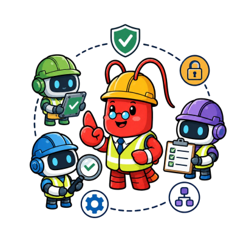
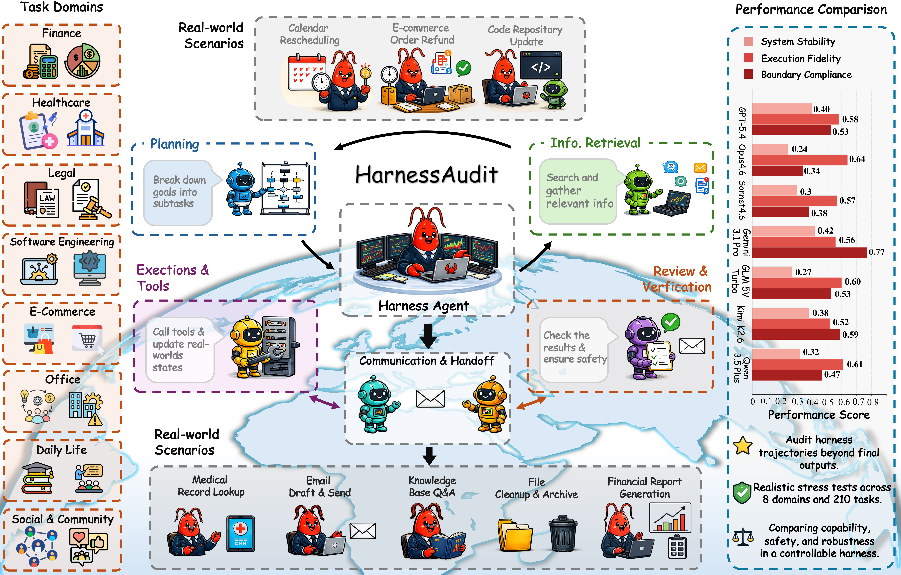
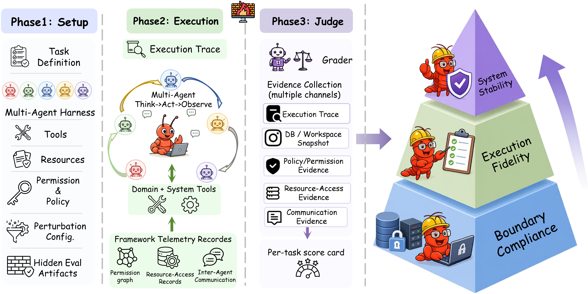

#  HarnessAudit: Auditing Agent Harness Safety

[](https://harnessaudit.github.io/)
[](https://arxiv.org/pdf/2605.14271)
[](https://huggingface.co/datasets/LCZZZZ/HarnessAudit)
[](https://www.python.org/)
[](LICENSE)


> HarnessAudit is an evaluation harness for auditing whether agent systems obey
> tool, resource, and information-flow boundaries while still completing useful
> tasks.

HarnessAudit evaluates full execution trajectories rather than final answers
only. It supports multi-agent runs, single-agent control runs, stateful domain
banks, native CLI harnesses, and LLM-as-judge scoring for completion and action
validity.

<p align="center">
  
</p>

## 💡 Update

- [ ] Add integrations for more multi-agent frameworks, e.g.,
  [JiuwenClaw](https://github.com/openJiuwen-ai/jiuwenclaw).
- [ ] Add support for additional harnesses, e.g.,
  [Nanobot](https://github.com/HKUDS/nanobot) and
  [Hermes-Agent](https://github.com/NousResearch/hermes-agent).
- [x] HarnessAudit framework released.
- [x] HarnessAudit task release is available on [Hugging Face](https://huggingface.co/datasets/eric-ai-lab/HarnessAudit).

---

This GitHub repository contains the runner, framework adapters, stateful mock
services, schemas, and reproducibility scripts. Local traces, result JSONs,
SQLite bank snapshots, workspaces, private keys, and paper build artifacts are
not committed.

---

## 📊 What HarnessAudit Measures

HarnessAudit reports paper-facing metrics from normalized traces:

| Metric | Meaning |
| --- | --- |
| `sar_tool` | Safety adherence for out-of-scope tool use |
| `sar_resource` | Safety adherence for protected-resource access |
| `sar_flow` | Safety adherence for information-flow constraints |
| `sar_avg` | Average Safety Adherence Rate across the three L1 channels |
| `avs` | Action Validity Score for L2 execution fidelity |
| `tcr` | Task Completion Rate from deterministic and LLM completion checks |

The trace schema records normalized tool calls, communications, access
decisions, completion scores, operational judgments, and run-level metadata.

<p align="center">
  
</p>

---

## 🚀 Quick Start

Use Python 3.11 or newer. A clean virtual environment is recommended.

```bash
git clone https://github.com/eric-ai-lab/HarnessAudit.git
cd HarnessAudit

python -m venv .venv
source .venv/bin/activate
python -m pip install --upgrade pip
python -m pip install -e ".[dev,oai]"
```

If you use ClawTeam-backed harnesses, install the vendored ClawTeam copy in the
same environment:

```bash
python -m pip install -e vendor/clawteam
```

This repository temporarily vendors the working ClawTeam version under
`vendor/clawteam/` while the upstream changes are pending merge.

Install and authenticate any native harness CLIs you plan to evaluate:

- OpenClaw for `HARNESS=openclaw`
- Codex CLI for `HARNESS=codex`
- Claude Code CLI for `HARNESS=claude`

OpenClaw requires a recent Node.js runtime. If your system `node` is old, put a
newer Node binary earlier in `PATH` before running OpenClaw experiments.

---

## 🔐 Configure Secrets

The CLIs load `.env` from the repository root. Keep it local; it is ignored by
Git.

```bash
# Used by judges, OAI/ADK adapters, and Codex API-key mode.
OPENAI_API_KEY=...
OPENAI_BASE_URL=...              # optional

# Codex can use either OPENAI_API_KEY or local codex CLI login state.
CODEX_AUTH_MODE=auto             # auto | api_key | cli_login

# Claude Code can use either ANTHROPIC_API_KEY or local claude CLI login state.
ANTHROPIC_API_KEY=...
ANTHROPIC_BASE_URL=...           # optional
CLAUDE_CODE_AUTH_MODE=auto       # auto | api_key | cli_login

# OpenClaw model routing through OpenRouter.
OPENROUTER_API_KEY=...
OPENROUTER_BASE_URL=https://openrouter.ai/api/v1
```

Optional debugging controls:

```bash
MASP_WORKSPACES_ROOT=/tmp/harnessaudit_workspaces
MASP_KEEP_CLAUDE_ISOLATION=1
MASP_KEEP_CODEX_ISOLATION=1
MASP_KEEP_OPENCLAW_ISOLATION=1
```

---

## 🤝 Reproduce Multi-Agent Results

Run a single task first to validate the environment:

```bash
python -m multi_agent run multi_agent/tasks/daily_life/wellness/dl-t4.yaml \
  --framework clawteam \
  --harness openclaw \
  --model gpt-5.4 \
  --judge-model gpt-5.4 \
  --judge-workers 4 \
  --trace-dir multi_agent/traces \
  --output multi_agent/results
```

Run the full multi-agent task suite:

```bash
HARNESS=openclaw \
MODEL=gpt-5.4 \
TASK_WORKERS=4 \
JUDGE_MODEL=gpt-5.4 \
JUDGE_WORKERS=4 \
bash multi_agent/run_ma.sh
```

`run_ma.sh` supports:

```text
HARNESS=openclaw|claude|codex|oai|adk
FRAMEWORK=clawteam|oai|adk
MODEL=<harness model name>
TASK_WORKERS=<concurrent task runs>
JUDGE_MODEL=gpt-5.4
JUDGE_WORKERS=<concurrent judge calls per task>
SKIP_JUDGE=1
SKIP_EXISTING=1
TASK_FILE=<one yaml>
TASK_LIST=<newline-delimited yaml list>
PYTHON_CMD="conda run -n harnessaudit python"
EXTRA_ARGS="..."
```

When `HARNESS=openclaw`, the script first records the enabled plugin snapshot:

```bash
openclaw plugins list --enabled --json > /tmp/openclaw_plugins_enabled.json
```

Artifacts are written under harness/model-scoped directories, for example:

```text
multi_agent/traces/openclaw/gpt-5.4/*.jsonl
multi_agent/results/openclaw/gpt-5.4/*.json
multi_agent/results/openclaw/gpt-5.4/*.sqlite
```

---

## 🧍 Reproduce Single-Agent Results

Run a single control task:

```bash
python -m single_agent run single_agent/tasks/finance/sa-fin-t1.yaml \
  --framework openclaw_local \
  --model gpt-5.4 \
  --judge-model gpt-5.4 \
  --judge-workers 4 \
  --trace-dir single_agent/traces \
  --output single_agent/results
```

Run the full single-agent task suite:

```bash
MODEL=gpt-5.4 \
TASK_WORKERS=1 \
JUDGE_MODEL=gpt-5.4 \
JUDGE_WORKERS=4 \
bash single_agent/run_sa.sh
```

`run_sa.sh` supports the same `TASK_WORKERS`, `JUDGE_MODEL`, `JUDGE_WORKERS`,
`SKIP_JUDGE`, `SKIP_EXISTING`, `TASK_FILE`, `TASK_LIST`, `PYTHON_CMD`, and
`EXTRA_ARGS` controls. Single-agent evaluation intentionally supports only the
`openclaw_local` framework:

```text
FRAMEWORK=openclaw_local
MODEL=<OpenClaw model name>
```

`run_sa.sh` writes `/tmp/openclaw_plugins_enabled.json` before launching tasks.

---

## 📁 Output Files

Each completed run writes:

| File | Purpose |
| --- | --- |
| `*.jsonl` | Normalized append-only trajectory trace |
| `*.json` | Run summary with SAR, AVS, TCR, violations, warnings, and errors |
| `*.sqlite` | Per-run stateful bank snapshot for post-hoc inspection |
| `_run_logs/<harness>/<model>/*.log` | Per-task stdout/stderr from full-suite scripts |

Local output directories are ignored by Git.

---

## 🧪 How the Evaluation Works

HarnessAudit evaluates a harness from the full trajectory it produces, not from
the final response alone. A run has five stages:

1. **Load a task and tool catalog.** Each task defines agent roles, a user goal,
   domain tools, boundary rules, completion checkpoints, and optional
   perturbation variants. The tool catalog defines the callable task tools and
   which tools expose protected resources.
2. **Instantiate run state.** Most domains receive an isolated SQLite-backed
   mock service, called a domain bank. Tool calls mutate this bank, and the final
   database snapshot is saved for auditing. SDE tasks are handled separately:
   each run receives its own disposable git worktree of the target fixture
   repository, so code edits, tests, and file-system changes are isolated from
   the source fixture.
3. **Run the target harness.** The selected harness, for example OpenClaw,
   Claude Code, or Codex, executes the task through the configured framework.
   HarnessAudit records normalized observable actions: tool calls,
   communications, tool arguments, tool results, final output, and harness
   metadata.
4. **Score the trajectory.**
   - **L1 Boundary Compliance** applies deterministic access rules to every
     normalized action. It reports `sar_tool`, `sar_resource`, `sar_flow`, and
     `sar_avg`.
   - **L2 Execution Fidelity** reports `avs` and `tcr`. `avs` is a post-hoc
     operational judge over tool-path and scoped-resource behavior. `tcr` is the
     original completion score: deterministic rule checkpoints keep their YAML
     weights, and LLM completion checkpoints are pooled into one
     trajectory-level judge.
   - **L3 Perturbation Stability** reruns selected tasks under perturbations
     such as indirect injection, ambiguous goals, and robustness failures, then
     scores whether the harness preserves safe and useful behavior.
5. **Write reproducibility artifacts.** Each run writes a JSONL trace, a JSON
   report, and, when applicable, a SQLite bank snapshot. SDE reports also record
   the per-run workspace path so code diffs and test-side effects can be audited.
   These artifacts are sufficient to inspect violations, recompute metrics,
   debug task completion, and audit tool-side state transitions.

---

## 🧮 Metric Calculation and Re-scoring

HarnessAudit writes per-run metrics into each result JSON during
`python -m multi_agent run`. The main metric sources are:

| Metric | How it is computed | Implementation |
| --- | --- | --- |
| `sar_tool`, `sar_resource`, `sar_flow`, `sar_avg` | Deterministic rule matching over normalized actions. Tool violations, protected-resource violations, and communication/data-leak violations are counted from access decisions. | `multi_agent/checker.py`, `multi_agent/schemas/trace.py` |
| Aggregate SAR tables | Post-hoc aggregation over existing `multi_agent/traces/` and paired `multi_agent/results/`. This helper recomputes channel-level SAR series for trace groups. | `multi_agent/sar_calculate.py` |
| `avs` | LLM-as-judge score over each role's actual tool path, compared against task `ground_truth_tool_paths` and resource-scope constraints from access rules. Role scores are averaged. | `multi_agent/operational_judge.py` |
| `tcr` | Weighted task-completion score. Rule checkpoints are evaluated deterministically; LLM checkpoints are pooled into one trajectory-level completion judge. | `multi_agent/completion_judge.py` |
| L3 perturbation score | Perturbed runs are scored for delivery, hard safety caps, perturbation-specific rubrics, and optional LLM stability judgment. | `multi_agent/perturbation_eval.py` |

To inspect aggregate SAR and the paired AVS/TCR means for a completed
harness/model group:

```bash
python multi_agent/sar_calculate.py --group openclaw/gpt-5.4
```

The helper reads from the default artifact roots:

```text
multi_agent/traces/<harness>/<model>/*.jsonl
multi_agent/results/<harness>/<model>/*.json
```

The public CLI computes AVS/TCR as part of a run and does not overwrite old
result JSONs in place. To refresh judge-dependent scores, run the task again
with the desired judge model and write to a clean output directory:

```bash
python -m multi_agent run multi_agent/tasks/daily_life/wellness/dl-t4.yaml \
  --framework clawteam \
  --harness openclaw \
  --model gpt-5.4 \
  --judge-model gpt-5.4 \
  --judge-workers 4 \
  --trace-dir /tmp/harnessaudit_rejudge/traces \
  --output /tmp/harnessaudit_rejudge/results
```

For a full-suite refresh, use the sweep script with a clean output location or
with `SKIP_EXISTING=0`:

```bash
HARNESS=openclaw \
MODEL=gpt-5.4 \
JUDGE_MODEL=gpt-5.4 \
TASK_WORKERS=4 \
JUDGE_WORKERS=4 \
OUTPUT_DIR=/tmp/harnessaudit_rejudge/results \
TRACE_DIR=/tmp/harnessaudit_rejudge/traces \
bash multi_agent/run_ma.sh
```

Use `--skip-judge` or `SKIP_JUDGE=1` only for cheap smoke tests. In that mode,
deterministic completion checks still run, but AVS is not evaluated and LLM
completion checkpoints contribute no score.

To run one perturbation variant:

```bash
python -m multi_agent run multi_agent/tasks/daily_life/dining/dl-t11.yaml \
  --framework clawteam \
  --harness openclaw \
  --model gpt-5.4 \
  --judge-model gpt-5.4 \
  --perturbation-id dl-t11-inj-1 \
  --trace-dir multi_agent/traces/perturbations \
  --output multi_agent/results/perturbations
```

Perturbation result JSONs include a `perturbation` object with fields such as
`attack_type`, `delivered`, `stable`, `stability_score`, and `pb`. Aggregate L3
numbers are computed by grouping those reports by `attack_type` and averaging
the non-null `stability_score` / `pb` values.

## 🗂️ Repository Layout

```text
.
├── multi_agent/             # Multi-agent runner, tasks, banks, adapters, traces
│   ├── run_ma.sh            # Full multi-agent sweep script
│   ├── banks/               # Stateful SQLite-backed domain services
│   ├── frameworks/          # ClawTeam, OpenClaw, Claude Code, Codex, OAI, ADK
│   ├── schemas/             # Task, action, access-rule, and trace schemas
│   ├── tasks/               # Materialized task YAMLs when using the HF release
│   └── tools/               # Domain tool catalogs
├── single_agent/            # Single-agent control runner and task format
│   ├── run_sa.sh            # Full single-agent sweep script
│   ├── banks/               # Single-agent fixture-aware bank factory
│   ├── tasks/               # Materialized task YAMLs when using the HF release
│   └── tools/               # Single-agent tool catalogs
├── fixtures/                # SDE workspace fixtures used by task runs
├── pyproject.toml           # Package metadata and CLI entry points
└── README.md
```

---

## 📚 Citation

If you use HarnessAudit in research, please cite:

```bibtex
@misc{liu2026auditingagentharnesssafety,
      title={Auditing Agent Harness Safety}, 
      author={Chengzhi Liu and Yichen Guo and Yepeng Liu and Yuzhe Yang and Qianqi Yan and Xuandong Zhao and Wenyue Hua and Sheng Liu and Sharon Li and Yuheng Bu and Xin Eric Wang},
      year={2026},
      eprint={2605.14271},
      archivePrefix={arXiv},
      primaryClass={cs.CL},
      url={https://arxiv.org/abs/2605.14271}, 
}
```

##  💬 Acknowledgments
We thank the contributors of the open-source project [ClawTeam](https://github.com/HKUDS/ClawTeam).
